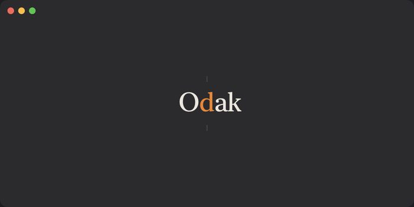

### Hi, I'm Halil 👋

I build calm, native apps for macOS, iOS and Android — small tools that do one thing well.

---

## [Odak](https://github.com/halil-balci/odak) — read one word at a time

A **free, open-source speed reader** for macOS, plus a browser extension for any OS.
Your eyes stay still; the words come to you.

[**⬇ Download for Mac**](https://github.com/halil-balci/odak/releases/latest) · [Browser extension](https://github.com/halil-balci/odak#browser-extension-chrome-edge-brave--any-os) · [Source](https://github.com/halil-balci/odak)

`SwiftUI` · `no dependencies` · `no tracking` · `MIT`

---

**Also:** [Swim101](https://github.com/halil-balci/swim101-support) (iOS) · Odak for iPhone & Android (in progress)

**Working with:** Swift / SwiftUI · Kotlin · Flutter · TypeScript
